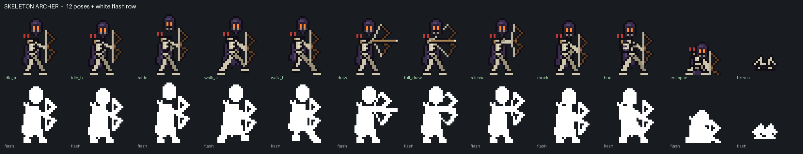

# Skeleton Archer — redesign



> **Status: shipped.** `assets/textures/archer_skeleton.png` is generated by
> `tools/make_archer_sprites.py`; the poses are driven by
> `scripts/enemies/archer_visuals.gd`. Nothing about the archer's *gameplay*
> changed — same HP, speed, damage, aim time, cooldowns and hitboxes.
>
> Regenerate the art with:
>
> ```
> python tools/make_archer_sprites.py
> ```
>
> (needs Pillow. It rewrites both the PNG and `images/archer_preview.png`.)
> Never hand-edit the PNG — the generator is the source of truth, exactly
> like `tools/make_slime_sprites.py`.
>
> Side by side with what it replaced:
> `images/archer_redesign_preview.png` (the old 16×16 placeholder next to
> the shipped rig).

---

## 1. Why touch it at all

The skeleton archer is the game's second enemy and the one that punishes you
from across the arena — but visually it is the weakest thing on screen:

| | now | problem |
|---|---|---|
| Sprite | **16×16**, one frame | smaller than the slime (32×32): the *ranged* threat is the least visible enemy |
| Detail | hood + 2 dots + a bone blob | no bow, no arrow, no arms — you cannot tell it shoots |
| Animation | `AnimationPlayer` bobs `position:y` | no pose changes: aiming, drawing and firing look identical |
| Read | dark purple block | at the game's 2× zoom it reads as "a purple rectangle" until it shoots you |

Everything else in the family got the generator treatment (slime: 12 poses +
flash row; hazards: real pixel art). The archer is the last placeholder.

## 2. The fantasy

> "It died with a quiver full of arrows and no intention of stopping."

The archer is not a soldier any more — it is a **rattling thing in a torn
hood** that keeps its distance and mocks you. The design brief (from the
player's words): **skeletal, scary, and annoying as hell.**

Three pillars, in priority order:

1. **Skeletal, not chibi.** Small head (7 px) on long, thin bones. A big round
   head reads as cute — the first blockouts failed exactly here.
2. **The face is two embers in a void.** Under the hood there is no face: a
   black opening with two burning eyes and the shadow of teeth. Cheap to draw,
   impossible to misread, and it survives being 26 px tall.
3. **It is always doing something at you.** Rattle while it aims, tilt its head
   mockingly after a shot, keep firing while it backs away. The silhouette
   should be annoying even when the mechanics are not.

## 3. Art rules

- **32×32 frames**, ground line at `y = 30`, figure ~26 px tall, feet on the
  origin (the scene's `Shadow` stays where it is).
- **One outline colour** (`#100E14`) closes the silhouette, like the slime.
- **Thin before anything else.** The first rig drew 4/3/2 px limbs and the two
  legs fused into a pair of trousers; a skeleton only reads as a skeleton when
  the bones are thin. Limbs are 3 px of outline around a 2 px core.
- **Bone is banded**, never a flat fill: `bone_hi #F0EAD4` / `bone #CEC6AC` /
  `bone_lo #968E76`. Ribs, skull and pelvis use all three. Limbs are too thin
  for three bands, so the *far* limb (the one behind the body) is drawn a band
  darker — that is what keeps a wide stance from collapsing into one blob.
- **Cloak is the dark frame**: `#382C4A` base, `#54426C` highlight, so the pale
  bones pop out of it.
- **Two embers per face**, `#FF8A30` with a `#FFE096` core pixel. The eyes are
  the only saturated thing on the sprite — that is what makes it read as
  *alive and wrong* at a glance.
- **Never colour-only:** the aiming pose changes the *silhouette* (bow limb
  drawn back, jaw open), not just a tint. Colour blindness must not matter.
- **Flash row** (row 1) is a pure-white silhouette of the same pose, exactly
  like the slime: `frame += 12` for a hit flash, zero shaders.

## 4. Palette

| Key | Hex | Use |
|---|---|---|
| `outline` | `#100E14` | every silhouette edge |
| `bone` | `#CEC6AC` | main bone |
| `bone_hi` | `#F0EAD4` | lit edge (skull crown, rib tips) |
| `bone_lo` | `#968E76` | shadowed bone, string |
| `cloak` | `#382C4A` | hood + cloak |
| `cloak_hi` | `#54426C` | hood lip, cloak fold |
| `cloak_lo` | `#1E162A` | torn hem, inside of the hood |
| `ember` | `#FF8A30` | eyes |
| `ember_hi` | `#FFE096` | eye core / flare |
| `wood` | `#60402A` | bow limbs |
| `wood_hi` | `#926438` | bow grip |
| `fletch` | `#BC3A36` | arrows in the quiver |
| `shaft` | `#A88454` | nocked arrow |

## 5. The 12 poses

Same 12-column grid as the slime, so the tooling, the flash row and the tests
are identical.

| # | Pose | What it must communicate |
|---|---|---|
| 0 | `idle_a` | standing, bow down, embers dim — "not my turn yet" |
| 1 | `idle_b` | 1 px sway, cloak hem shifts |
| 2 | `rattle` | **the tell**: jaw drops, shoulders rise, bones shake — used when it starts aiming |
| 3 | `walk_a` | stepping away from you, bow still low |
| 4 | `walk_b` | opposite step |
| 5 | `draw` | bow raised, string half pulled, arrow nocked |
| 6 | `full_draw` | string at the cheek, eyes flared, jaw open |
| 7 | `release` | string snapped forward, arms flung, empty bow |
| 8 | `mock` | 1 px head tilt + jaw open: "missed again" (plays after the shot) |
| 9 | `hurt` | knocked back, cloak snapped, skull jolted |
| 10 | `collapse` | knees fold, bow dropping |
| 11 | `bones` | a heap of bones on the floor (the death decal pose) |

## 6. Sheet + runtime plan

**Art**

- New `tools/make_archer_sprites.py`, same philosophy as the slime generator:
  ASCII-authored parts (`HEAD`, `HEAD_OPEN`, `RIBS`, `PELVIS`, `QUIVER`) +
  parametric limbs and bow, composed per pose from a small rig table.
  One command writes `assets/textures/archer_skeleton.png` (12 × 2 = 384×64)
  plus `docs/images/archer_preview.png`.
- Parts are authored in a `SYMBOLS` palette map, so re-colouring the whole
  creature (cold bone, necro green eyes) is a dict edit — good for the elite
  or a future "crypt archer" variant.

**Runtime** — mirror the slime, do not invent a second pattern:

| File | Change |
|---|---|
| `scripts/enemies/archer_visuals.gd` | **new**: `SlimeVisuals`-style state machine — `set_moving()`, `play_rattle()`, `play_draw(progress)`, `play_release()`, `play_mock()`, `play_hurt()`, `play_death()`, `flash()`, `set_variant_row()` |
| `scripts/enemies/archer.gd` | swap the `modulate`/`scale` tweens for visuals calls: aim → `play_draw(t/aim_duration)`, shoot → `play_release()` + `play_mock()`; keep every gameplay number and the red risk line untouched |
| `scenes/enemies/Archer.tscn` | `Visuals` becomes a `Node2D` holding `Body` (`hframes = 12`) + `Shadow`; `vframes = 2`; the `AnimationPlayer` bobs go away (the visuals script owns the bob) |
| `tests/archer_test.gd` | add: sheet is 12×2 / 384×64, a spawned archer shows a coloured frame, the aim state advances the draw frames, the flash row is used on hit |

**Collision stays identical** (body 12×14, hurtbox 15×16, feet on origin), so
every number in `archer.gd` and every existing archer test keeps its meaning.

## 7. Phases

- **A — art (this is most of the work):** generator, 12 poses, flash row,
  preview sheet, and a side-by-side "in an arena with a slime" check so the
  scale reads correctly next to the family.
- **B — runtime:** `archer_visuals.gd`, `archer.gd` hooks, scene rewrite,
  test updates.
- **C — polish:** death collapse + bone-heap decal, elite = ember eyes flare
  brighter (gold ring already exists), optional rattle SFX (procedural, like
  the slime's).

## 8. Risks

| Risk | Guardrail |
|---|---|
| Bigger sprite → attacks look like they land "in the air" | collider and hurtbox are unchanged; only pixels grow |
| Aim pose hides the red risk line | risk line is drawn on the floor (`z 0`, tree order) and the aim pose keeps the torso upright |
| The "mock" beat becomes noise | it plays once, after a shot, and never during a telegraph |
| 12 poses = a lot of art | parts are shared across poses; only the rig table changes between them |
| New art breaks `archer_test` | the test asserts poses/rows/behaviour, not pixels |

## 9. Decisions (settled)

1. **Silhouette** — hooded void with two ember eyes. No bare skull, no armour:
   the hood is what makes it read as "something under there" instead of a
   cartoon skeleton.
2. **How annoying** — *visuals only*. Rattle, tremble and the mocking head
   tilt. No faster shots, no double shot, no stat change of any kind.
3. **Palette** — aged yellow bone (`bone #CEC6AC`) with orange embers
   (`#FF8A30`). Cold-grey / necro-green stays on the shelf for a future
   variant; the palette lives in one `SYMBOLS` dict, so that is a small change.
4. **Scope** — all 12 poses, including `mock` and `bones`.

## 10. What shipped

| File | Role |
|---|---|
| `tools/make_archer_sprites.py` | the art. ASCII parts + a rig table per pose → the sheet and the preview. |
| `assets/textures/archer_skeleton.png` | 384×64, 12 poses × 2 rows (row 1 = white flash silhouettes). |
| `scripts/enemies/archer_visuals.gd` | `ArcherVisuals`: shamble, rattle, `play_draw(progress)`, `play_release()`, `play_mock()`, `play_hurt()`, `play_death()`, `flash()`. Owns the bob, the shadow and the dust. |
| `scripts/enemies/archer.gd` | AI only. Aim progress → `play_draw()`, shot → `play_release()` (+ a 1-in-3 head tilt), hit → `play_hurt()` + white flash, death → `play_death()` (no more 90° rotation). |
| `scenes/enemies/Archer.tscn` | `Visuals` is a `Node2D` (script) with `Shadow` + `Body` (`hframes 12`, `vframes 2`). The old bob `AnimationPlayer` is gone. |
| `tests/archer_test.gd` | section 7: sheet size, facing, walk/idle frames, draw → release → mock → hurt, flash row, collapse → bone heap, and a pin on every gameplay number the redesign promised to leave alone. |

**Frame maths**: `frame = pose + (flashing ? 12 : 0)`, with
`pose` in `0..11` in the order of section 5 and `hframes = 12`, `vframes = 2`.
The `Body` node uses `offset = (0, -7)` so the drawn feet land on the same
`y` the old 16×16 sprite used — the shadow, the hurtbox and the health bar did
not move a pixel.
