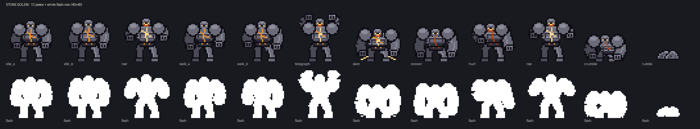

# Stone Golem — redesign



> **Status: shipped.** `assets/textures/golem_stone.png` is generated by
> `tools/make_golem_sprites.py`; the poses are driven by
> `scripts/enemies/golem_visuals.gd`. The fight is unchanged — same 90 HP,
> 30 px/s, 15 damage, 0.8 s telegraph, 0.9 s recovery, slam radius 46.
>
> Regenerate the art with:
>
> ```
> python tools/make_golem_sprites.py
> ```
>
> (needs Pillow; it rewrites both the PNG and `images/golem_preview.png`.)
> Never hand-edit the PNG — the generator is the source of truth.
>
> What it replaced: `images/golem_redesign_preview.png`.

---

## 1. Why touch it at all

The golem is the game's first *heavy* enemy — 90 HP, a slam that takes a fifth
of your health bar — and it looked like this:

| | before | problem |
|---|---|---|
| Sprite | **24×24**, one frame | smaller than the slime (32×32) and the archer (32×32): the heaviest enemy was the *least* visible |
| Shape | round grey blob with two cyan eyes | read as "friendly pebble"; nothing about it said 90 HP |
| Animation | one bob track on `Visuals:position` | the arm-raise telegraph, the slam and the recovery all looked identical |
| Feel | a `modulate` tint for the wind-up | **no weight at all**: no footfall, no dust, no drop |

The brief, in the player's words: **«گالم باید حس سنگینی و تستسترون بده»** —
it has to feel heavy, and it has to feel like a slab of muscle and rock.

## 2. The fantasy

> "It was carved to guard something. It forgot what, and kept the job."

Three pillars, in priority order:

1. **Heavy is a SHAPE.** A tiny head sunk between two boulder shoulders, arms
   that hang past the hips, a chest wider than the waist, legs so short they
   look like an afterthought. Every proportion is wrong for a person and
   perfect for a thing made of rock.
2. **Heavy is TIMING.** The stomp cycle holds each planted foot, the whole
   body *drops* 2 px on the footfall, dust kicks up and the camera nudges.
   None of that touches the AI — it still walks at exactly `move_speed`.
3. **The chest is the engine.** The stone is cracked open and burning amber.
   That is the only saturated colour on the sprite, and it gets brighter with
   every pose that costs the golem something (telegraph, slam, elite flare).

## 3. Art rules

- **40×40 frames**, ground line at `y = 37`, figure ~33 px tall, feet on the
  origin (`offset = (0, -7)` puts them exactly where the old 24×24 block had
  them). Bigger than both 32 px enemies, smaller than the 48 px boss.
- **Carved masonry, not a grey fill.** The chest is three courses of rock with
  a lit top bevel and a dark joint under each, plus offset vertical joints like
  a brick wall. A flat fill reads as cloth no matter how grey it is.
- **Banded stone**: `stone_hi #8C8B9A` / `stone #6B6A78` / `stone_lo #4A4956`
  / `stone_dark #2E2C38`. The far limb is always a band darker.
- **One dark rim** (`#0E0C12`) closes every limb, or the arms and legs melt into
  the torso at gameplay zoom.
- **Fists are drawn, not punched out.** An ASCII knuckle block with three
  finger grooves; a plain rectangle at this size read as a bucket (and, with a
  highlight and one ember pixel, briefly as a *face*).
- **Flash row** (row 1) is a pure-white silhouette of the same pose, exactly
  like the slime and the archer: `frame += 12` for a hit flash, zero shaders.
- **Check it at 2×**, not at 10×: `images/golem_game_zoom.png` is the sheet at
  the camera's real zoom, next to the archer and a slime.

## 4. Palette

| Key | Hex | Use |
|---|---|---|
| `outline` | `#0E0C12` | every silhouette edge |
| `stone_hi` | `#8C8B9A` | lit bevels, shoulder caps |
| `stone` | `#6B6A78` | main rock |
| `stone_lo` | `#4A4956` | shadowed rock, far limbs |
| `stone_dark` | `#2E2C38` | joints, undersides, contact shadows |
| `amber` | `#FF9426` | chest seams, eyes, floor cracks |
| `amber_hi` | `#FFD989` | the heart of the seam |
| `ember_deep` | `#B04416` | a seam that is dying down |

## 5. The 12 poses

| # | Pose | What it must communicate |
|---|---|---|
| 0 | `idle_a` | hunched, fists by the knees, seams dim |
| 1 | `idle_b` | breath in: chest up, seams a little brighter |
| 2 | `roar` | **the testosterone beat**: head up, jaw open, arms flung wide |
| 3 | `walk_a` | stomp, left foot planted, body dropped |
| 4 | `walk_b` | stomp, right foot planted |
| 5 | `telegraph` | **both fists overhead** — the 0.8 s dodge window |
| 6 | `slam` | fists driven into the floor, ground cracking under them |
| 7 | `recover` | stuck in the ground, slumped, seams almost out (the punish window) |
| 8 | `hurt` | knocked back a step, one arm up |
| 9 | `rise` | elite UPRISING: arms spread, seams blazing |
| 10 | `crumble` | knees gone, folding sideways |
| 11 | `rubble` | the pile that is left behind |

## 6. Runtime

| File | Role |
|---|---|
| `tools/make_golem_sprites.py` | the art: ASCII parts (head, fist, rubble) + a rig table per pose. |
| `assets/textures/golem_stone.png` | 480×80, 12 poses × 2 rows (row 1 = white flash silhouettes). |
| `scripts/enemies/golem_visuals.gd` | `GolemVisuals`: stomp cycle with footfall dust + camera nudge, `play_telegraph(progress)`, `play_slam()`, `play_recover()`, `play_roar()`, `play_rise()`, `play_hurt()`, `play_death()`, `flash()`. Owns the shadow and every particle. |
| `scripts/enemies/golem.gd` | AI only. Arm-raise → `play_telegraph()`, impact → `play_slam()`, stuck → `play_recover()`, hit → `play_hurt()` + white flash, death → `play_death()`, elite → `play_rise()`. |
| `scenes/enemies/Golem.tscn` | `Visuals` is a `Node2D` with `Shadow` + `Body` (`hframes 12`, `vframes 2`). The bob `AnimationPlayer` is gone. |
| `tests/golem_test.gd` | the whole fight (telegraph → one-shot slam → recovery window → elite package → crumble) plus the rig, and a pin on every gameplay number. |

**Frame maths**: `frame = pose + (flashing ? 12 : 0)`, `hframes = 12`,
`vframes = 2`. The health bar moved up to `y = -28` so it clears the head
(the old scene default sat inside the new silhouette).

## 7. Decisions (settled)

1. **Silhouette** — the brute: tiny head, boulder shoulders, arms to the knees,
   short wide stance. Not an ancient idol, not a faceless wall, not a crystal
   golem.
2. **Palette** — cold basalt with amber seams burning through the chest.
3. **Heaviness scope** — *juice*: footstep dust, footstep camera nudge, slam
   dust, deadline hitstop. **No** new attack, no stat change, no AI change.
4. **Scope** — all 12 poses, including `roar` and `rise`.

## 8. Risks

| Risk | Guardrail |
|---|---|
| Bigger sprite → the slam looks like it lands in the air | collider (20×20), hurtbox (24×24) and the 46 px slam circle are untouched; only pixels grew |
| Footstep shake becomes noise | 1.2 amplitude / 0.12 s, and only while walking; `footstep_shake = 0` switches it off |
| A pose gets stuck because the AI forgot to clear it | `roar`, `hurt` and `rise` end themselves after their own duration; `slam`/`recover` are owned by the AI state machine, which always exits them |
| New art breaks the fight | `tests/golem_test.gd` drives the real state machine and pins the numbers |
