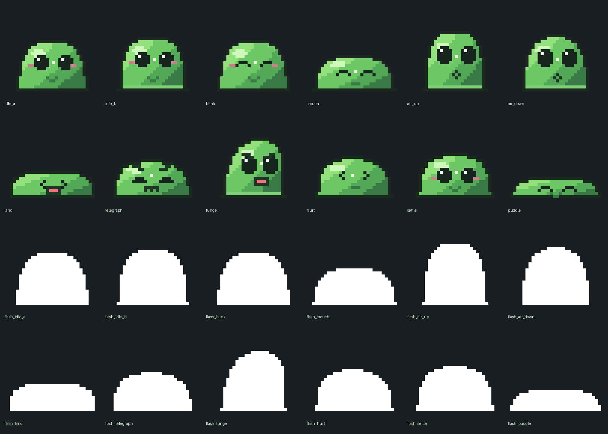

# Slime Redesign — “one good blob, forever”



> **Status:** implemented. This document is the plan we designed against
> *and* the reference for anything slime-shaped from now on. If a future
> change to the slime disagrees with this file, one of the two is a bug.

---

## 1. The problem, stated honestly

The slime was a **16×16 white square** (`white_pixel.png`) tinted green with
`self_modulate`, animated by sliding the square up 2 px and back:

| Symptom | Root cause |
| --- | --- |
| Reads as a green box, not a creature | There is no silhouette — a square has none |
| No volume, no wetness | One flat colour, no lighting, no specular |
| "Animations" are bobs | `AnimationPlayer` only moved `Visuals:position` |
| Hits are unreadable | Flash = `self_modulate = white`, which on a **white** texture changes nothing |
| No character | No face at all |
| Attacks feel mushy | Telegraph/lunge were scale tweens on a square |

Every one of those is a *content* problem, not a tuning problem, so no amount
of extra tweening was going to fix it. The fix had to be: **real art with a
real silhouette, plus a place that owns animation properly.**

## 2. Goals / non-goals

**Goals**

1. A rounded, unmistakably *jelly* silhouette at 32×32, consistent with the
   game's existing pixel-art look (dark 1 px outline, banded shading).
2. Clean, readable animation set: breathe, blink, hop, land, wind-up, lunge,
   hurt, die — each pose a purpose, not a decoration.
3. A white hit flash that actually flashes.
4. Keep every gameplay contract intact: same HP, same 40 px/s crawl, same
   stop distance, same telegraph/lunge timings, same `died` / `health_changed`
   signals, same headless tests (extended, not weakened).
5. Make the *look* reusable: a second slime variant should be an Inspector
   colour, not a new scene.

**Non-goals (for this pass)**

- New slime abilities or AI (that is a balance change, not an art change).
- A skeletal/wobble shader (see §9 — deliberately deferred, it is the one
  piece that needs a live GPU to tune properly).
- Boss-tier slime variants.

## 3. Art direction

```
OUTLINE  #1A281E   deep near-black rim, closes the silhouette
DEEP     #3A7A46   bottom-right rim
SHADE    #52A856   shaded belly / right side
BASE     #6CC864   the slime green (== the old body_color)
LIGHT    #92E07C   top-left light band
BOUNCE   #7ED076   translucent bounce light along the base
SPEC     #CEF8BA   specular blob (wet gloss)
EYE      #16261E   eyes (never pure black — it reads as a hole)
GLINT    #FAFFF5   1 px eye glint
```

- **Shape language:** a filled dome — broad crown, gently rolling bottom
  edge, 6 % flare at the base so the body *sits in* its own goo. Never a
  rectangle, never a circle; a circle reads as a ball, a dome reads as jelly.
- **Lighting:** single light from the top-left, quantised into **flat bands**
  (4 tones + specular). Flat bands are what keep it looking like pixel art
  instead of a blurry gradient.
- **Translucency:** the bottom row gets a bright `BOUNCE` tone, so the slime
  looks like light is passing through it. This one row does more for
  "goo" than any particle effect.
- **Face:** two 5×5 eyes with a 1 px glint, tiny 2-px cheeks of blush, and a
  3–5 px mouth. At game scale (2× zoom) the eyes must be the only thing you
  can make out at a glance — that is the read that says "alive".

## 4. The sheet

`assets/textures/slime.png` — **384×64**, generated, never hand-edited:

| | 0 | 1 | 2 | 3 | 4 | 5 | 6 | 7 | 8 | 9 | 10 | 11 |
|---|---|---|---|---|---|---|---|---|---|---|---|---|
| **row 0** | idle_a | idle_b | blink | crouch | air_up | air_down | land | telegraph | lunge | hurt | settle | puddle |
| **row 1** | ↳ | ↳ | ↳ | ↳ | ↳ | ↳ | ↳ | ↳ | ↳ | ↳ | ↳ | ↳ |

Row 1 is the **same pose as a pure-white silhouette**. The hit flash is
therefore `frame += 12` for 0.1 s — exact outline, zero shaders, zero extra
nodes, and it cannot desynchronise from the pose the slime is actually in.

Three companion textures live next to it:

- `slime_shadow.png` (32×10) — feathered oval shadow.
- `slime_goo_puddle.png` (32×10) — the wet base / landing splat / death decal.
- `docs/images/slime_preview.png` — the contact sheet above, for review.

Everything is produced by:

```bash
python tools/make_slime_sprites.py
```

The generator draws a **parametric dome** (`rx`, `ry`, dome fullness, lean)
and overlays a shared face. That is why no two poses can drift into looking
like different creatures — poses are the same body under different forces.

## 5. Animation state machine

```
                    ┌─────────────── set_moving(true) ───────────────┐
                    ▼                                                │
  idle (breath + blink) ──► crouch 0.10s ──► air_up/air_down 0.30s ──► land 0.05s ──► settle 0.07s
        ▲                                                                  │
        └──────────────────────── set_moving(false) ───────────────────────┘

  play_telegraph()  : crouch low, lean back, red tint, tremble   (AI duration)
  play_lunge()      : long body, +2 px lean, mouth open           (AI duration)
  play_recover()    : back to idle/hop
  play_hurt()       : flinch 0.16s, then back to idle/hop
  play_death()      : puddle pose + goo burst + floor decal
```

Rules that keep it clean:

- **One owner.** `slime_visuals.gd` writes `Body.frame`, `Body.scale`,
  `Body.position`, the shadow and the puddle. Nothing else touches them.
- **No tween pile-ups.** The locomotion/hop values are *computed* from a
  phase each frame instead of being tweened, so interrupting a hop with a
  lunge can never leave a half-finished tween fighting the new pose.
- **Volume-ish squash & stretch.** `_squash` grows X while shrinking Y
  (`scale = 1 ± squash`), and stretch (from hop height) does the inverse.
  The art carries the big shape change; the scale is a 5–10 % accent.

## 6. Locomotion: the hop is visual-only (a deliberate compromise)

The obvious "proper" fix is hop-based *physics*: crouch → airborne → land,
velocity applied only while airborne. It looks fantastic and it **breaks the
AI contract** — the slime would move in 18 px bursts, and the existing
headless suite asserts "12–28 px travelled in 0.5 s", "stops at ~24 px",
"does not drift once adjacent". Rebalancing those tests around a jump curve
is a gameplay change smuggled in behind an art task.

So: **physics stays a constant crawl, the sprite hops.** The body lifts
`hop_height` px along a sine arc, the shadow shrinks and fades in exactly
the same proportion, and the frames switch crouch → air → land. At 40 px/s
one hop cycle covers ~21 px, which reads as hopping while the collision
capsule never leaves the floor. Result: identical gameplay, better feel,
zero test churn.

*If we later want hop-physics*, the change is localised: replace the
constant `velocity` in `_chase_player()` with a phase-driven impulse and
relax the speed assertions in `tests/combat_test.gd` §5. The visuals file
already exposes the same phases.

## 7. Juice checklist (all shipped)

| Moment | Effect |
| --- | --- |
| Idle | 2-frame breath + randomised blink (2.2–5.2 s, randomised first blink so a wave never blinks in lockstep) |
| Moving | crouch → arc → splat hop cycle, arc-driven squash & stretch |
| Landing | 3 goo droplets (`CPUParticles2D`, one-shot, self-freeing) |
| Height | shadow scales 1.0 → 0.72 and fades 0.55 → 0.20 with lift |
| Wet base | `Puddle` sprite under the feet, brighter while grounded |
| Wind-up | red tint, tremble ±0.8 px, gathering squash — reads before the lunge |
| Lunge | long lean-in pose, 2 px lift, mouth open, tint cleared |
| Hit | white silhouette row for `flash_duration` + hurt pose + flinch squash |
| Death | flatten to puddle + 16-droplet goo burst + floor decal that fades over 1.4 s |
| Elite | +8 % size and a warm tint on top of the shared golden ring |

## 8. Architecture

```text
scenes/enemies/Slime.tscn           Visuals (Node2D + slime_visuals.gd)
                                    ├── Shadow   (Sprite2D, slime_shadow.png)
                                    ├── Puddle   (Sprite2D, slime_goo_puddle.png)
                                    └── Body     (Sprite2D, slime.png, 12×2)
scripts/enemies/slime.gd            AI + health + signals + audio   (unchanged contract)
scripts/enemies/slime_visuals.gd    every pixel, phase and particle
tools/make_slime_sprites.py         the only source of truth for the art
```

The public surface of `slime_visuals.gd` is deliberately tiny:

```gdscript
set_facing(x)          # look left/right
set_moving(on)         # hop cycle on/off (safe to call every physics frame)
set_goo_color(color)   # per-variant goo colour
play_telegraph()  play_lunge()  play_recover()  play_hurt()  play_death()
flash(seconds)    is_flashing()    become_elite()
```

`slime.gd` no longer knows what a frame is. That is the point: the next
enemy can copy `slime_visuals.gd` and keep its own brain.

## 9. Deliberately deferred

1. **Jelly wobble shader** (`VERTEX` sine driven by `UV.y`, bottom pinned).
   It is the one item that genuinely needs eyes on a running GPU to tune —
   amplitude that looks like jelly at 640×360 can look like a glitch on a
   different zoom. Ship it as a follow-up with a live preview, not blind.
2. **Secondary variants** (toxic/blue, fire/orange). The sheet is monochrome
   by design; `set_goo_color()` plus a palette-swap shader gets 90 % there.
3. **Goo trail** while hopping (decals left on the floor). Cheap, but it
   needs a decal budget so a 40-slime wave does not litter the arena.
4. **Ground-splash on walls** when a hop ends against geometry.

## 10. Verification

```bash
godot --headless --path . tests/combat_test.tscn
godot --headless --path . tests/archer_test.tscn
godot --headless --path . tests/boss_test.tscn
godot --headless --path . tests/heroes_and_dash_test.tscn
```

New assertions in `tests/combat_test.gd`:

- the slime body really is the 12×2 / 384×64 pose sheet (a green box would fail),
- a ground shadow and a goo puddle exist,
- the idle pose is frame 0–1, not the flash row,
- a hit switches `Body.frame` to the white row (`>= 12`) and `is_flashing()`
  is true, and both revert after 0.1 s.

Manual smoke test (30 s): stand still → the slime breathes and blinks; walk
into range → it hops toward you; let it reach 34 px → red tremble, lunge,
recover; punch it → white silhouette + flinch; kill it → goo puddle decal
stays on the floor for a moment.

> Note: the three new PNGs carry no `.import` file yet — Godot writes those
> on first editor open (or on the first headless run). Commit them with the
> art, as usual.

## 11. Definition of done

- [x] Rounded, outlined, lit dome silhouette — no squares anywhere
- [x] 12 poses with a face, generated parametrically from one dome
- [x] True white hit flash (silhouette row), not a colour multiply
- [x] Hop / land / wind-up / lunge / hurt / death animations wired to the AI
- [x] Shadow + goo base react to hop height
- [x] Death leaves a goo decal and a droplet burst
- [x] Elite slimes visibly upgraded without new art
- [x] Zero AI/gameplay changes; headless suite extended and green
- [x] One command rebuilds every texture
