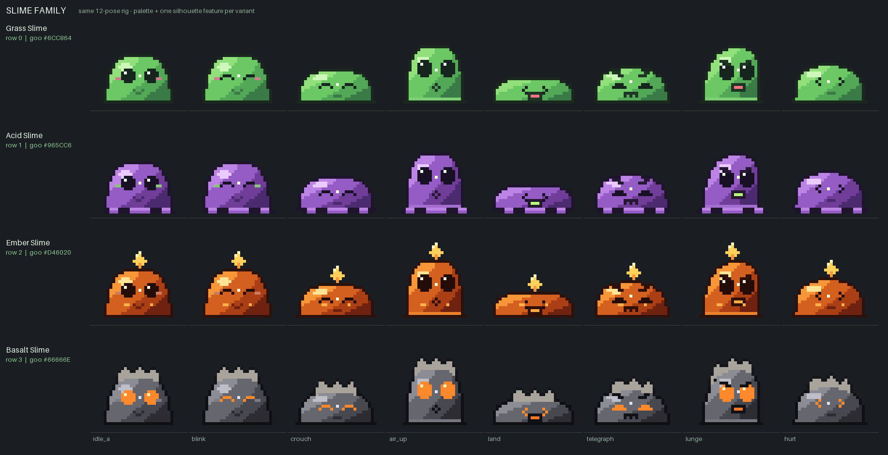
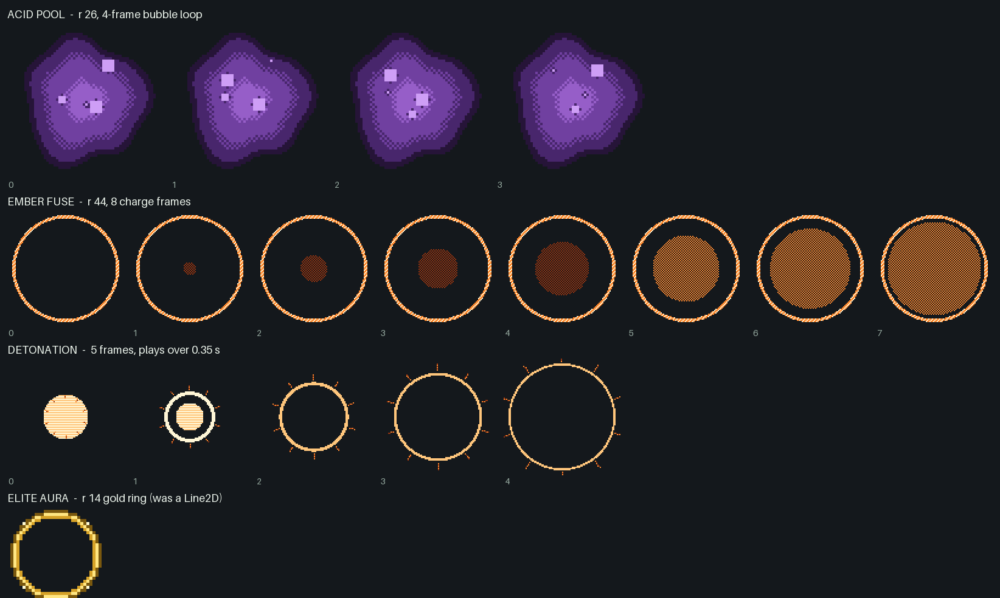

# Slime Variants — the danger ladder



The danger zones those variants leave on the floor are pixel art too
(`tools/make_fx_sprites.py`):



> **Status: Phase V1 shipped.** The chassis + **Acid, Ember and Basalt** are in
> the game; Frost, Splitter, Void and the King Slime are designed but **not
> built** (V2/V3, see §5). Deferred on purpose: the boss slot stays with the
> Forest Colossus, and the minimap keeps one blip colour for every slime.
>
> The preview above is now **real generated art** — `tools/make_slime_sprites.py`
> draws every row from the same parametric dome, so the sheet in the game and
> the picture above are byte-identical.
>
> Verify with:
>
> ```bash
> godot --headless --path . tests/slime_variants_test.tscn
> ```

---

## 1. The fantasy

> "The deeper you go, the less the dungeon bothers to look friendly."

Wave 1 slimes are a tutorial. By wave 20 the player should be able to identify
**what a slime will do to them from across the arena**, in under a second, from
a 32×32 sprite. Danger grows in three independent dials:

1. **Stats** — HP / speed / damage (already handled by `wave_spawner` scaling).
2. **Mechanic** — one new threat per variant (acid pool, fuse, chill, spikes…).
3. **Mix** — the *weight* of nasty variants inside the slime slot ramps with the
   wave, so the same 6 slimes on wave 8 and wave 22 are a different fight.

## 2. Design rules (non-negotiable)

1. **Same body, different creature.** Every variant reuses the identical 12-pose
   rig; only palette + one silhouette feature + eye style change. That is what
   makes the family read as a family.
2. **Never colour-only.** Each variant owns a *shape* difference (spikes, shards,
   crown, horns, dots) so colour-blind players read it too, and so it survives
   the dark arena background.
3. **One new toy per variant**, and at most one new toy every ~3 waves. Nothing
   is scarier than a mechanic you had no time to learn.
4. **The warning never shrinks.** The existing "tremble + red tint, then lunge"
   telegraph is sacred. Variants may add a *second* beat (fuse, blink wind-up),
   never remove the first.
5. **Everything is answerable with the current verbs** — walk, punch, dash.
   No variant may require a verb the player does not have.
6. **Danger budget.** A wave may contain at most two *hazard-producing* variants
   (acid pools / embers / voids) at once, otherwise the floor becomes soup.

## 3. The eight

Base slime for reference: **30 HP · 40 px/s (cap 90) · 8 dmg · 0.35 s telegraph · 170 px/s lunge · 1.2 s cooldown.**

| # | Variant | Colour | Silhouette / face | Mechanic (the one new toy) | Telegraph read | Counter-play |
|---|---|---|---|---|---|---|
| 1 ✅ | **Grass Slime** | the shipped green `#6CC864` | — (baseline) | none: chase + lunge | red tremble | the tutorial |
| 2 ✅ | **Acid Slime** | violet `#9662C6` + acid-lime tongue | drips under the body | **dies into an acid pool**: r=26, 3 dmg every 0.5 s, 4 s (≈24 dmg if you stand in it) | purple tremble; the pool appears with a splash | kill it away from where you want to stand |
| 3 ✅ | **Ember Slime** | orange `#D46020` + hot cracks | flame crest on the crown | **unstable fuse**: 0.55 s after death it detonates (r=44, 14 dmg + shake). Chain-reacts with other embers | white-hot pulsing + a growing ground circle | kill at range, or commit to a dash out |
| 4 · V2 | **Frost Slime** | ice cyan `#72C0D8` | 3 ice shards on the crown | **chill on hit**: −30 % move speed for 1.5 s (dash still clean) | pale-blue tremble, shards glint | do not trade hits; kill it before the lunge |
| 5 ✅ | **Basalt Slime** | slate `#666E76` + amber eyes | stone spikes over the dome | **spiked body**: 4 contact damage (0.8 s tick), heavy knockback on its lunge, 1.6× HP, 0.75× speed | amber tremble, slow heavy lunge | never walk through it; punish the recovery |
| 6 · V2 | **Splitter Slime** | magenta `#D0629E` + foam dots | baby-blob dots on the shell | **splits into 2 minis** on death (40 % HP, 1.25× speed, 0.68× size, 4 dmg) | pops loudly; minis have a tiny squeak | wide/AoE hits, kill it far from you |
| 7 · V3 | **Void Slime** | near-black violet `#3E2E60`, glowing white eyes | jagged horns | **blink**: every 3.5 s, if you are >110 px away, it fades out (0.25 s) and reappears ~90 px behind you, then lunges hard (12 dmg) | fade-out + a dark smear where it left | stay close; the blink is the tell |
| 8 · V3 | **King Slime** *(boss — deferred by decision)* | olive-gold `#A8C858` | gold crown, gem band | **SLAM** (r=70, 1.0 s telegraph) + **SUMMON** (2–3 grass/acid slimes, hard cap 6 alive). Enrages under 30 % HP | floor circle grows while it winds up | clear the adds, punish the slam recovery |

✅ = shipped in V1. Stat multipliers (**applied on top of the wave bonus**, i.e.
the variant multiplies whatever the spawner wrote — the same ordering the elite
3× HP uses, so "wave-20 basalt" is a tanky *wave-20* slime, not a wave-1 one):

| Variant | HP | Speed | Damage | Telegraph | Notes |
|---|---|---|---|---|---|
| Grass | ×1.0 | ×1.0 | ×1.0 | ×1.0 | baseline |
| Acid | ×1.25 | ×0.9 | ×1.0 | ×1.15 | slower, tankier, punishes camping |
| Ember | ×0.75 | ×1.15 | ×0.9 | ×0.85 | fast and fragile: a race |
| Frost | ×1.0 | ×1.0 | ×0.75 | ×1.0 | cheap hits that cost you tempo |
| Basalt | ×1.6 | ×0.75 | ×1.25 | ×1.3 | a wall with teeth |
| Splitter | ×0.9 | ×1.0 | ×1.0 | ×1.0 | total HP is 0.9 + 2×0.36 ≈ 1.6× |
| Void | ×1.1 | ×1.05 | ×1.5 | ×0.8 | late-game executioner |
| King | 550 + 60/wave | 32 | 16 | 1.0 | boss, not part of the slime slot |

## 4. The danger curve (spawn weights *inside* the slime slot)

Archers and golems keep their own rolls (`archer_chance`, `golem_chance`); the
slime slot then rolls a variant. Weights are 0 below the unlock wave.

| Wave | Grass | Acid | Ember | Frost | Basalt | Splitter | Void |
|---|---|---|---|---|---|---|---|
| 1–2 | 100 | — | — | — | — | — | — |
| 3–5 | 70 | 30 | — | — | — | — | — |
| 6–8 | 50 | 25 | 25 | — | — | — | — |
| 9–11 | 35 | 20 | 20 | 25 | — | — | — |
| 12–14 | 25 | 15 | 20 | 15 | 25 | — | — |
| 15–17 | 20 | 15 | 15 | 15 | 15 | 20 | — |
| 18–21 | 15 | 10 | 15 | 15 | 15 | 15 | 15 |
| 22+ | 8 | 10 | 15 | 15 | 17 | 15 | 20 |

Elites keep working exactly as today (gold ring, 3× HP, RAGE): an **elite Void**
is a wave you remember. Elite variants still only roll from `elite_start_wave`.

Boss waves: `boss_interval = 5` → Colossus. Proposal: **King Slime on every
10th wave** (10, 20, 30…), Colossus on the others (5, 15, 25…), so the two
bosses alternate instead of one replacing the other.

## 5. Implementation plan

### Phase V1 — the chassis + 3 variants ✅ SHIPPED

**As built** (file → what it does):

| File | What landed |
|---|---|
| `tools/make_slime_sprites.py` | palettes per variant + silhouette feature painters (`feature_spikes`, `feature_flame_crest`, `feature_hot_cracks`, `feature_acid_splash`); emits `slime.png` as **12 × 8** (4 variants × art+flash × 12 poses) plus both review sheets |
| `scripts/enemies/slime_variant.gd` | `class_name SlimeVariant` — the data registry (`DATA`) and the wave ladder (`WAVE_TABLE`, `pick_for_wave`). No scene needed to unit-test it |
| `scripts/enemies/slime_visuals.gd` | `set_variant(row)`; `frame = row * 24 + (flash ? 12 : 0) + pose` |
| `scripts/enemies/slime.gd` | `@export variant_id` + `_apply_variant()` (stats, goo colour, sheet row) + three hooks: `_update_contact_damage()` (basalt), `_on_death_effect()` (acid / ember) |
| `scripts/enemies/wave_spawner.gd` | slime-family sub-roll right after `instantiate()` (before `add_child`, so `_ready()` sees it); node names advertise the variant (`AcidSlime_W3_7`) |
| `scenes/fx/AcidPool.tscn` + `scripts/fx/acid_pool.gd` | **pixel-art** puddle (4-frame bubble loop): r 26, 3 dmg / 0.5 s, 4 s life, 0.9 s fade-out, **max 6 live** |
| `scenes/fx/EmberBlast.tscn` + `scripts/fx/ember_blast.gd` | 0.55 s fuse drawn as 8 **pixel-art** charge frames, then one r 44 / 14 dmg blast (5-frame shockwave + particles) — and it **lights the fuse of every other ember in the radius**, so a cluster pops as a cascade |
| `tools/make_fx_sprites.py` | generator for the hazard art: acid pool strip, ember ring strip, detonation strip + `docs/images/slime_hazards_preview.png` |
| `scripts/fx/pixel_shapes.gd` | `PixelShapes.filled_disc/ring`: hazards that follow a live number (the boss telegraph) drawn as 1-px rows instead of vector circles |
| `scenes/enemies/Slime.tscn` | `vframes` 2 → 8 |
| `tests/slime_variants_test.gd` + `.tscn` | 60+ checks: registry, ladder, per-variant stats & rows, pool tick/expiry/cap, fuse timing & single hit, contact tick, grass passivity |
| `tests/combat_test.gd` | sheet assertions moved to the family layout (`frame % 24`) |

**Three decisions taken while building** (they differ from the proposal, on
purpose):

1. **The acid pool and the ember fuse live in the arena, not on the slime.** The
   corpse is `queue_free()`d 0.3 s after death, so an `await`-based fuse on the
   slime would never resume. Both FX are sibling nodes of the Enemies parent;
   the slime only spawns and positions them.
2. **Multipliers are applied in `_ready()`, i.e. after the spawner's wave bonus.**
   Identical ordering to `become_elite()`'s ×3 HP, so elite + variant stacks
   predictably instead of fighting each other.
3. **Hazards are pixel art, not `_draw()` circles.** `draw_circle()` is
   rasterised at the *window* resolution, so the first shippable version of the
   acid pool and the ember fuse looked like smooth vector rings floating under a
   pixel-art world. Both are now pre-rendered strips at **1 texture pixel = 1
   game pixel**, generated at exactly the damaging radius and never scaled at
   runtime (see `docs/images/slime_hazards_preview.png`).
4. **The fuse pulses but never grows.** An earlier draft scaled the ember body
   while charging; that would have made the painted circle look smaller than the
   real blast. A telegraph that lies is worse than no telegraph.

The live V1 ladder (the V2/V3 columns in §4 are folded into basalt until those
variants ship):

| Wave | Grass | Acid | Ember | Basalt |
|---|---|---|---|---|
| 1–2 | 100 | — | — | — |
| 3–5 | 70 | 30 | — | — |
| 6–8 | 50 | 25 | 25 | — |
| 9–11 | 40 | 20 | 25 | 15 |
| 12–17 | 30 | 20 | 25 | 25 |
| 18+ | 20 | 20 | 30 | 30 |

### Phase V2 — status + splits

- `player_base.gd`: `apply_chill(duration, factor)` + a tinted HUD hint;
  `frost` hooks it from `_on_lunge_connected()`.
- Splitter: `_on_death_effect()` spawns 2 minis through a spawner helper
  (`spawn_mini(parent, hp, speed)`), capped so a wave can never exceed +6 minis.

### Phase V3 — Void + King

- Void blink: `_update_void_blink(delta)` — fade out 0.25 s, teleport 90 px behind
  the player (clamped inside `arena_rect`), fade in, then a forced lunge.
- `scenes/enemies/KingSlime.tscn` + `scripts/enemies/king_slime.gd` reusing
  `GroundTelegraph` and the Colossus's SLAM pattern, plus SUMMON.
- `wave_spawner.gd`: alternate King (10, 20, 30) with Colossus (5, 15, 25).

### Files touched (estimate)

| File | Change |
|---|---|
| `tools/make_slime_sprites.py` | +180 lines (palettes, feature painters, multi-row sheet) |
| `scripts/enemies/slime_variant.gd` | new, ~140 lines (registry + wave table) |
| `scripts/enemies/slime.gd` | +90 lines (variant apply + 3 hooks) |
| `scripts/enemies/slime_visuals.gd` | +15 lines (row offset) |
| `scripts/enemies/wave_spawner.gd` | +35 lines (sub-roll, King, mini spawn) |
| `scenes/fx/AcidPool.tscn`, `scripts/fx/acid_pool.gd` | new, ~80 lines |
| `scripts/player/player_base.gd` | +25 lines (chill) |
| `scripts/enemies/king_slime.gd`, `scenes/enemies/KingSlime.tscn` | new (V3) |
| `tests/slime_variants_test.gd` | new, ~200 lines |
| `docs/SLIME_VARIANTS.md` | this document, updated to "implemented" per phase |

## 6. Why this is cheap to build

Everything reuses machinery that already exists and is tested:

- the 12-pose rig and the white-flash row (`SLIME_REDESIGN.md`),
- `GroundTelegraph` (painted danger circles) from the Colossus,
- the `Elite` helper (gold ring + 3× HP) — variants are orthogonal to elites,
- the spawner's signal-based flow and the `died` contract,
- the procedural-SFX generator for per-variant hit/death sounds (a palette of
  pitch shifts, not new audio files).

## 7. Risks & guardrails

| Risk | Guardrail |
|---|---|
| Visual noise with 8 palettes + archers + golems | silhouette features, one blip colour on the minimap (decided: keep it uniform), late waves get *fewer* slimes per slot |
| Difficulty cliff from stacking DoTs | one new toy / 3 waves, hazard cap (**6 live acid pools**, enforced in `acid_pool.gd`), and the pool stops hurting while it fades |
| Splitter snowball on elite waves | hard cap of minis per wave (+6) and no splitting of minis |
| Void blink feeling unfair | always 0.25 s fade-out, never blinks closer than 60 px, forced lunge is telegraphed |
| Colour-blind readability | every variant carries a shape feature, never colour-only |

## 8. Decisions (answered before V1 was built)

| Question | Decision |
|---|---|
| Scope now | **V1 only**: chassis + Acid / Ember / Basalt |
| Floor hazards | **Yes** — acid pool DoT and the ember fuse, exactly as designed |
| King Slime vs Colossus | **Leave the boss slot alone.** King Slime is deferred to V3 |
| Mini-map colours | **One colour for every slime** — the variant reads from the sprite, not the blip |

## 9. What V1 still does *not* do

- Frost / Splitter / Void and the King Slime (designed above, not built).
- No per-variant minimap colours (decided).
- No "max 2 hazard producers per wave" rule: with only three variants and a
  25–30 % ember share the arena stays readable, and the 6-pool cap is the real
  guardrail. Revisit when Splitter ships.
- Nothing new for the player: the answer to every variant is still walk, punch,
  dash — no new button, no new resource.
