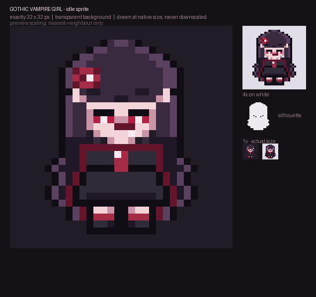

# Gothic vampire girl — 32×32 idle sprite



> **Status: idle sprite delivered — animations not started (waiting for approval).**
> The sprite is generated by `tools/make_vampire_idle.py`; the generator holds the
> ASCII grid that *is* the sprite, so the art can be reviewed and corrected one
> pixel at a time in a diff. Never hand-edit the PNGs — regenerate:
>
> ```bash
> python tools/make_vampire_idle.py     # needs Pillow
> ```

## 1. Files

| file | what it is | tracked |
|---|---|---|
| `assets/sprites/vampire/vampire_idle.png` | **the sprite**: 32×32, RGBA, transparent bg | source |
| `assets/sprites/vampire/vampire_idle.aseprite` | editable source (1 frame, 1 layer, 11-entry palette) | source |
| `tools/make_vampire_idle.py` | the generator + the pixel grid (authoritative) | source |
| `assets/sprites/vampire/palette.png` | palette sheet with hex codes | source |
| `assets/sprites/vampire/vampire.gpl` | same palette for Aseprite / GIMP / Aseprite-import | source |
| `docs/images/vampire_idle_x16.png` | 512×512, nearest-neighbour ×16, transparent | preview |
| `docs/images/vampire_idle_x32.png` | 1024×1024, nearest-neighbour ×32, transparent | preview |
| `docs/images/vampire_idle_preview.png` | review sheet: ×14, ×4 on white, silhouette, 1× | preview |

Source art lives under `assets/sprites/vampire/`, review images under `docs/images/`
— they are never mixed.

## 2. What the sprite has to say, in priority order

The brief asked for a readable idle at 100 %, so the sprite is built in this order
and this is the order to defend if something has to go:

1. **The face.** 10 px of pale skin inside a near-black hair mass — the only
   bright thing on the sprite, so the eye finds her first. A 3 px lash line, then
   the crimson iris row with one white catchlight per eye, a shadow row under the
   eyes, and a 3 px lip weighted to her left with the fang hanging under it.
2. **The hair.** A pointed crown at y2 that sweeps out to 18 px at its widest,
   two falls down to y26 so the mass frames the face instead of sitting on it,
   and a `L` (light purple) highlight running down the outer edge of each fall so
   the silhouette separates from a dark floor.
3. **The rose.** 3×3 on her left temple (image-left): `d R R / R d w / d R R`.
   The spiral *and* the single `w` pixel are both load-bearing — without the
   spiral it reads as a berry, and a plain `w` centre needs a dark pixel beside
   it or it becomes a white eye.
4. **Cloth.** High crimson collar, black bodice with a crimson brooch and belt
   buckle, flared skirt, and a dark cloak flanking the dress with the deep
   crimson lining on its **inner** edge. That is the brief's "cloak with crimson
   inner lining" — visible on every frame, not only at the hem.
5. **Vampire markers.** Two 2 px pointed ears (shaded `q`, never bare white),
   crimson irises, one fang, crimson boot bands.

## 3. Technical rules this file enforces

`tools/make_vampire_idle.py` refuses to write anything unless:

- the grid is **exactly 32 rows × 32 columns** (a ragged row silently shifts art —
  it is a hard error here);
- every character is in `PALETTE` (a typo cannot become a stray colour);
- every opaque pixel is 4-connected to the body (**no floating confetti** — the
  drafts grew smudges off the cloak edges and on the hair);
- the `.aseprite` written at the end is **read back and decoded**, and its pixels
  are compared with the PNG. If the bytes are wrong, the run fails.

Scaling happens in exactly one place: `build_preview()` / `zoomed()`, always
`Image.NEAREST`, always on a copy. The sprite is drawn at 32×32 and is never
resized.

## 4. Palette

| role | hex | sym | notes |
|---|---|---|---|
| outline | `#100D14` | `K` | every silhouette edge, the lash line, the belt |
| hair shadow | `#211827` | `p` | hair shadow, cloak body, skirt shade |
| hair base | `#392A40` | `P` | hair mass, ear frame |
| hair highlight | `#59415F` | `L` | crown edge, outer edge of each fall |
| cloak crimson | `#65152B` | `d` | collar, cloak lining, rose shadow, lips |
| rose / accents | `#A52C46` | `R` | rose, brooch, belt buckle, boot bands |
| skin | `#F2D4D9` | `s` | face, neck, thighs, ear |
| skin shadow | `#C994A5` | `q` | under-eye band, cheeks, ear shade |
| highlight | `#F8EAF0` | `w` | eye catchlight, brooch pin, fang, rose sparkle |
| clothing | `#302B38` | `g` | bodice, skirt, boots |
| iris | `#B32044` | `r` | crimson iris (split from `#A52C46` so accents stay distinct) |

11 colours are used, all within the brief's ten plus the one split. House range is
14–24 per frame, so this is a deliberate reduction for readability.

## 5. Proportions (kept identical in every future frame)

```
y2 ..y15   head (14 px tall incl. hair, 10 px face)     centreline between x15 / x16
y16..y20   torso (collar, bodice, belt)                 18 px wide at the shoulders
y21..y25   skirt + cloak flare                          20 px wide at the hem
y26..y29   legs: bare thigh, boot band, boot shaft, sole  soles on row 29
```

Soles on **row 29** match every other hero in the game, so a future sheet can drop
straight into the existing `Sprite2D`/`AtlasTexture` rigs.

## 6. Animation plan (not started)

All frames must reuse this exact head, palette, and vertical budget:

| set | frames | notes |
|---|---|---|
| idle | 4 (frame 0 = this sprite) | 1 px breath on the shoulders, hair fall sway in 2 px steps |
| walk | 4 | legs swap under the skirt, cloak tails lag one frame |
| run | 4 | wider skirt flare, hair lifted 2 px |
| attack | 4 | wind-up + Crimson Blood Splash release (droplets, never a filled polygon) |
| hurt | 2 | head back 1 px, eyes shut / flinch |
| death | 4 | collapse, hair over the body |

Hair that moves must move in **2 px steps over 4-row blocks**: a 1 px alternation
reads as a dotted line, not as hair (a lesson already paid for on Velmira).

## 7. Decisions settled — do not retry

- **Rose as a solid red blob** → reads as a berry/strawberry. Spiral + one
  highlight pixel instead.
- **White pixel as the rose centre with no dark neighbour adjacent** → reads as an
  eye. The `d` beside it fixes it.
- **Ears as 2 px skin blocks floating outside the hair** → read as white horns or
  headphones. Ear = 1 px tip + shaded base, tucked against the face.
- **Cloak lightened to separate it from the dress** → becomes lilac wings that read
  as sleeves. The cloak stays dark; it separates by *silhouette*, not by value.
- **A crimson stripe down the cloak's outer edge** → reads as a red outline/error.
  Lining goes on the inner edge.
- **Arms hanging outside the torso** → 4 px of parchment beside the dress; the
  figure reads as wide as a box. Arms stay inside the cloak silhouette; hands are
  left out entirely at this size.
- **1 px noise / sparkles near the silhouette** → the floating-pixel check in
  `validate()` now fails the build instead of shipping them.
- **Bigger, wider face** → the first passes had a 16 px face and the hair vanished
  into a helmet. 10 px face, hair mass wider than the shoulders.

## 8. Soft spots / risks

- The cloak/dress split is a 2-value split (`p` cloak vs `g` dress) inside a
  near-black area. It reads on a mid floor, less so on pure black. Check her on the
  actual arena floor before adding contrast.
- The ears are 1 px tips. They are the smallest read on the sprite; if they ever
  look like noise in motion, drop them and let the hair cover the ears (the
  reference sheet draws it both ways).
- `vampire_idle.aseprite` is written to the published spec and round-trip verified
  by the generator, but it has not been opened in Aseprite inside this environment.
  If Aseprite ever refuses it, the `.png` plus `ROWS` in the generator remain the
  authoritative source and can be re-exported from there.
- The game's own vampire, **Velmira**, still uses `assets/textures/player_shabnam.png`
  (a 192×32 six-frame sheet, see `VELMIRA_REDESIGN.md`). This sprite is a new,
  independent character asset and does **not** overwrite her. Wiring it into
  `Shabnam.tscn` / `character_registry.gd` needs a six-frame sheet first.
