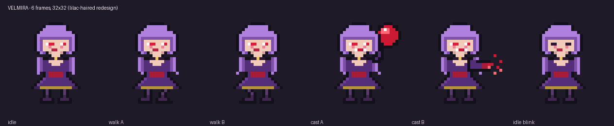

# Velmira — redesign



> **Status: shipped.** `assets/textures/player_shabnam.png` is generated by
> `tools/make_velmira_sprites.py`. The sheet is **192×32 = six 32×32 frames in
> the same order**, so `scenes/player/Shabnam.tscn` (AtlasTextures at
> x = 0/32/64/96/128/160) and `scripts/player/character_registry.gd` are
> untouched.
>
> Regenerate the art with:
>
> ```
> python tools/make_velmira_sprites.py
> ```
>
> (needs Pillow; it rewrites both the PNG and `images/velmira_preview.png`.)
> Never hand-edit the PNG — the generator is the source of truth.

---

## 1. Why touch it at all

Two goes at this. The **first** redesign (a navy bob and a navy coat) was
rejected: at gameplay zoom she was a dark blob with a pale mask. The brief for
the **second** one, in the player's words: **«یه خانوم خون اشام جذاب با موهای
یاسی رنگ و بلند ... کاملا برخلاف قبلیه و آرت استایل بقیه کرکتر هارو هم رعایت
کنه»** — an attractive vampire woman, lilac hair, long, nothing like the
previous one, and drawn in the same style as the other heroes.

| | first redesign | problem |
|---|---|---|
| Values | navy hair + navy coat + cool grey skin | everything in the same dark band: at 2× she was a silhouette |
| Shape | bob that stopped at the jaw | no motion, no read from behind |
| Style | invented colour scheme | next to Borzo / Bahman / Sylvara she looked like a different game |

## 2. The fantasy

> "She is the last of a house that drank its own wine. She keeps the manners,
> and the appetite."

The reference is the anime-style vampire portrait — but the player asked for
**long lilac hair** instead of the portrait's blunt bob, so the hair is the
signature, not the fringe.

Five reads, in priority order — this is the order they were built, and the
order to defend them if one has to go:

1. **Value contrast, not detail.** Light lilac hair (226,196,248) and warm pale
   skin (242,202,186) against a dark violet gown (84,46,120). The eye finds her
   face first at 2× zoom, which is what the first redesign failed at.
2. **Long hair that moves.** Two 2 px falls from the temples to the waist,
   drawn *over* the dress, with the tips drifting a pixel between the walk
   frames.
3. **A gown, not a box.** 13 px shoulders → 9 px waist → 17 px hem: a real
   A-line silhouette with a crimson underbust sash.
4. **A face you can read at 2×.** 9 px of skin inside a 15 px head, white
   sclera + crimson iris, blush under the eyes, a 2 px mouth.
5. **Blood only where it means something.** Crimson sash, crimson irises, the
   orb in the wind-up and the spray in the release — nothing else is red.

## 3. House style (learned from the other three heroes)

Read `player_pari.png`, `player_borzo.png` and `player_bahman.png` before
touching this file:

- **same outline**: (18,16,24) on every silhouette edge, no exceptions;
- **flat 2-tone cloth**: each material is a base + one highlight (+ shadow for
  the gown), never a gradient;
- **chibi proportion**: the head is about as wide as the shoulders, the figure
  is ~28 px tall and the boots land on **row 29** like every other hero;
- **14–24 colours**, and the palette is *bright*.  Blue, gold, green, red —
  nobody in this game wears near-black;
- **eyes are one row**: a white sclera pixel next to a coloured iris pixel. A
  2-row eye reads as a visor at this size (tried, reverted).

## 4. Art rules

- **Vertical budget** (`y 2..12` head, `y 13..24` dress, `y 25..29` legs,
  soles on row 29) is written in the generator as a comment *and* enforced by
  the anchors — the first draft spent 34 rows and Godot cut her boots off.
- **Every part is a rectangle.** `check_widths()` walks the module globals and
  fails the build with the part's name if a row is short. A ragged row does not
  error on its own — it silently shifts the paste and you find out two frames
  later.
- **Rows are built, not counted.** `_face()` writes a head row as
  *hair + 9 px face + hair* and `_seg()` centres a body segment in the 17 px
  torso block, so the waist and the hem can move without anyone recounting
  characters.
- **The hair is drawn after the dress** (so it hangs in front of the shoulders)
  and the head is drawn last.
- **1 px highlights on thin limbs go muddy at 2×** — highlights live on the
  hair and the boot cuffs only.

## 5. Palette

| role | colour | notes |
|---|---|---|
| outline | `#121018` | every silhouette edge (house colour) |
| hair / hi / lo | `#B080DE` / `#E2C4F8` / `#7E50A8` | lilac, light falls on the outside |
| skin / hi / lo | `#F2CABA` / `#FDE8E0` / `#D0A09E` | pale but **warm** |
| blush | `#EE8294` | one row under the eyes |
| sclera / iris | `#FAFAFF` / `#D6203E` | the only pure red on the face |
| lip | `#B22646` | 2 px |
| dress / hi / lo | `#542E78` / `#6E4098` / `#3C2058` | the dark mass of the sprite |
| crimson / hi | `#A81C38` / `#CE3450` | underbust sash, gloves |
| gold / lo | `#F0C660` / `#BA923A` | choker gem, hem trim |
| tights / boot | `#583A6C` / `#40264E` | legs stay the darkest part |
| blood / hi | `#CC1A34` / `#FF6876` | orb and droplets |

## 6. The six frames

| frame | role in `Shabnam.tscn` | what it says |
|---|---|---|
| 0 | idle | weight on both feet, hair still, hands in the sleeves |
| 1 | walk A | left leg forward, hair tips drift right |
| 2 | walk B | right leg forward, hair tips drift left |
| 3 | cast A | wind-up: mouth open with fangs, glove raised beside the head with a blood orb |
| 4 | cast B | release: arm thrust forward, a fan of droplets |
| 5 | idle blink | frame 0 with both lids shut (played at 2.20–2.40 s) |

Frame 4 is a **read, not a hitbox**: the real 92 px damage cone is drawn by the
FX node. The sprite only has to say "blood, that way", which is why it is a
handful of droplets and not a filled polygon (a polygon reads as a flag, and
clipped at the frame edge).

## 7. The generator

```
PAL            the table above
SYMBOLS        ASCII char -> palette entry ('.' = transparent)
_face(row)     "hair + 9 px face + hair"  (head rows, 15 px)
_seg(row)      a centred body segment inside the 17 px torso block
HEAD / HEAD_BLINK / HEAD_OPEN   15 x 11 head (fringe, eyes, blush, mouth, chin)
TORSO                           17 x 12 dress (neckline, sash, A-line skirt)
LEGS_STAND / LEGS_STEP_A / STEP_B   13 x 5 legs, soles on the last row
ARM_UP / ARM_OUT                the two cast poses
hair_falls(img, sway)           the two long falls (drawn over the dress)
blood_orb / blood_spray         the two blood reads
frame_idle / frame_walk / frame_cast / build_sheet / build_preview
```

Anchors: `HEAD_X 9, HEAD_Y 2` (head is 15 px wide), `TORSO_X 8, TORSO_Y 13`
(dress is 17 px wide), `LEGS_X 10, LEGS_Y 25`. Everything is centred on
`CX = 16`.

Every frame is the **same head** and the **same dress** with a different leg
set, arm set and hair sway — so a change to her waist moves in all six frames
at once. That is the whole reason this is a script and not six hand-drawn PNGs.

## 8. What did not change

- `player_shabnam.png` is still **192×32**, six frames, frames in the same
  order → `Shabnam.tscn` needs no edit.
- `tests/heroes_and_dash_test.gd` still asserts the 192×32 sheet.
- `character_registry.gd` keeps the Persian-cast file names (`Shabnam`) and
  the display name `Velmira`, accent `(0.98, 0.30, 0.45)`.
- No `.gd` file was touched. No gameplay number moved: 85 HP,
  `move_speed 104`, Blood Splash 17 DMG / 92 px, −6 HP cast / +8 HP per hit,
  dash 0 DMG with no phasing.

## 9. Decisions (settled — do not retry)

- **Dark navy hair + dark navy coat** → a black blob at 2×. Light hair over a
  dark gown is the fix, and it is not negotiable.
- **A bob** → no motion and no read; the player asked for long hair.
- **Arms as separate 3 px blocks** → double outlines and "pauldron" shoulders.
  The wide sleeves are part of the torso block; only the cast arms are pasted.
- **Hands as 2×2 red blocks on the skirt** → they read as red patches. Removed.
- **2-row eyes (white above iris)** → sunglasses. One row, sclera beside iris.
- **A brow-shadow band across the forehead** → a grey stripe. It came out.
- **A face that fills the head** → a mask; 9 of 15 px, with 2 px of hair beside
  it on every row.
- **Crimson across the whole hem** → a second red band competing with the sash;
  the hem is gold now.

## 10. Risks / what is still soft

- She reads as a *girl in a violet gown* more than as a *vampire*: the vampire
  cues are the eyes, the sash, the choker gem and the blood magic. If that
  needs to be louder, the next lever is a high collar or a cape at the
  shoulders — not more detail on the face.
- The head is big even by this game's chibi standard (15 px hair mass on a 13 px
  shoulder line). It is deliberate — the hair is the character — but it is the
  first thing to shrink if she reads as too young.
- The falls are straight vertical columns. A proper S-curve would need a wider
  block and a per-frame variant.
